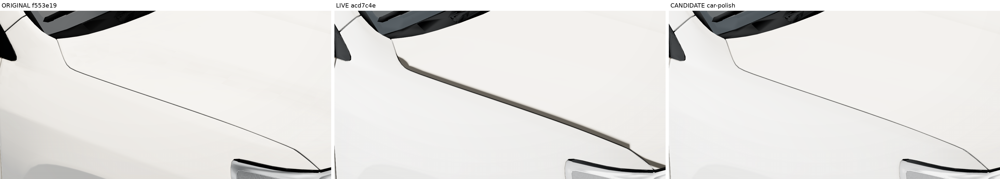
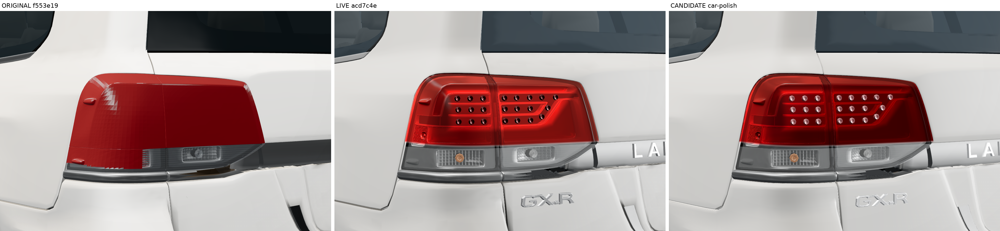

# LC200 close-up fix review

Branch: `car-polish`. Implementation: `6316e96`. Audit rig merged by fast-forward to `1875259`.
ORIGINAL: `f553e19`. LIVE: `acd7c4e` (`origin/main`).

**Review candidate: the strict zero-green visual acceptance gate is not passed.**
The brown bonnet band and added gap overlays are removed, the plate is physically shaded, handle cups are clean, and LED pods reflect without emitting light. Remaining original-to-candidate detail changes are recorded without changing the audit threshold. Some remain on the requested seams/handles; this is not a claim that the acceptance gate passed.

Main and Pages are unchanged. A fetched Pages response matches Main's `index.html` byte-for-byte; see [verification](pages-unchanged.json).

## Evidence

All comparison panels read **ORIGINAL | LIVE | CANDIDATE**, left to right.

- [All 76 audit sheets](sheets/), generated by the unchanged `tools/audit/sheet.mjs`, and its [changes.json](changes.json).
- [30 native-resolution comparisons](crops/) covering every item 1–12; [crop coordinates](crop-index.json). No registration, resizing or retouching of the crop pixels.
- [Gate overlays](gates/) and [gate numbers / exact ROIs](gates.json). Cyan identifies the measured line or rectangle; green uses the audit's unchanged 16 px block, 8 px blur radius and mean absolute detail threshold > 5.
- [pixels.json](pixels.json): CIELAB D65 measurements, plate face / adjacent bumper rectangles, 7×7 median samples on all 22 visible LED pods per side, compared with the median of a 14–20 px surrounding annulus. Each sample has explicit pixel coordinates.
- [Changed values, old → new, file and line](changed-values.json); [every new file](new-files.json).
- [Asset verification](assets.json), [runtime/capture provenance](provenance.json), [unedited capture logs and PNG hashes](captures/), [test results](validation/).

**Measured acceptance results**

- Viewer **31/31**, including `overhangLock`, Cream + Slate; workshop **31/31**; final console errors **0**.
- All **54** pre-existing GLBs byte-identical; the two additions are documented below.
- White plate face mean **L*68.29**, adjacent bumper **L*71.17**: brightness gate passes. Black-paint close-up plate face **L*67.20**.
- LED pods pz: **22/22** brighter than their surrounding annulus; minimum ΔL* **25.99**. Runtime emission is zero; see [material state](validation/material-state.json).
- LED pods nz: **22/22** brighter than their surrounding annulus; minimum ΔL* **7.89**. Runtime emission is zero; see [material state](validation/material-state.json).

The prescribed zero-green condition is **not passed (0/9 strict-zero ROIs)**. Counts below use the original audit threshold. These counts are not silently treated as harmless.

| Gate ROI | ORIGINAL→LIVE marked blocks | ORIGINAL→CANDIDATE marked blocks |
|---|---:|---:|
| bonnet-edge-pz | 169 | 11 |
| bonnet-edge-nz | 122 | 54 |
| black-bonnet-edge | 161 | 65 |
| phone-bonnet-edge-pz | 270 | 160 |
| front-door-pz | 105 | 89 |
| front-door-nz | 107 | 84 |
| rear-door-pz | 87 | 80 |
| rear-door-nz | 90 | 79 |
| door-handles-pz | 152 | 68 |

The phone row includes a projection mismatch. [Eight supplemental phone sheets](projection-supplement/sheets/) use the original phone intrinsics for every build: the bonnet ROI then has **6** marked blocks, versus **160** in the prescribed capture. The long bonnet edge is unmarked in the aligned comparison; isolated marks remain near the windscreen junction/curve. This does **not** turn the prescribed strict-zero result into a pass.

The final lens/bonnet adjustment keeps Clay visually unchanged: compared with `f3828c4`, the two full Clay images differ at **1** and **6** pixels respectively, maximum channel delta **21**. This is **not** a pixel-identical claim; [raw parity results](validation/clay-pixel-parity.json) are included.

[Full-size Cream/Slate presets and Clay audit views](views/).

## Item-by-item review

| Item | Cause and change | Native-resolution proof |
|---|---|---|
| 1. Bonnet/wing edge | Removed `useBonnetBoundary` completely: no 6 mm / .98 hem. Source cavity coefficients replace the extra seam/sharp-gap multipliers. Bonnet surface cleanup remains. Existing baked cavity shading also compensates for the strong −z studio irradiance on the folded lip; it does not draw a line or distance band. Thin edge is restored visually, but the strict no-green gate remains unmet. | [White +z](crops/01-bonnet-edge-pz.png), [white −z](crops/01-bonnet-edge-nz.png), [black](crops/01-black-bonnet-edge.png), [phone emulation](crops/01-phone-bonnet-edge-pz.png) |
| 2. Roof ribs | Strong seam darkening and suppressed ridge highlights made the stored raised ribs read like ink. Restored the source ridge/cavity response while keeping flat-panel cleanup. No roof mesh or NORMAL changes. | [Top](crops/02-roof-top.png), [rear roof](crops/02-roof-rear.png) |
| 3. Panel outlines | Removed added paint seam strength .70 and sharp-gap strength .45, and restored original cavity weights. Flat paint stays clean; no new drawn gap bands. Residual original-to-candidate detail changes are explicitly reported. | [Front door +z](crops/03-front-door-pz.png), [front door −z](crops/03-front-door-nz.png), [rear door +z](crops/03-rear-door-pz.png), [rear door −z](crops/03-rear-door-nz.png), [quarter](crops/03-rear-quarter-pz.png), [tailgate](crops/03-tailgate.png) |
| 4. LED pods | Original replacement-lamp cap geometry retained. Changed only pod colour/roughness/metalness/environment/clearcoat so the pods are reflective silvery red, with pinpoint highlights. Default emission remains zero. Reduced red lens/guide environment intensity from .35 to .006 to remove the white softbox wash that hid the unlit pods. Lens colour, opacity, gloss-coat parameters, geometry and the real split remain. All 44 measured pods are now lighter than their local lens surroundings. | [Lamp +z](crops/04-tail-lamp-pz.png), [lamp −z](crops/04-tail-lamp-nz.png), [phone emulation](crops/04-phone-tail-pz.png) |
| 5. Handle recesses | Cleanup was removing cavity shading in the finger cups; part-specific mask programs also need distinct cache keys. Protected the four cups and kept part-specific paint cache keys after removing the gap overlay. Handle hardware gets the original chrome response in its own material zone; neighbouring belt/side chrome is retained. Reflections still differ from ORIGINAL's softbox environment, so zero green on the handle is not achieved. | [Handle](crops/05-door-handles-pz.png), plus the four door crops above |
| 6. Front plate | Removed the outgoing-light replacement that produced a white rectangle. Added a rounded, physically lit blank plate/frame inside the old footprint. Only the old loose plate component is hidden through a material zone in a new bumper variant. | [Front plate](crops/06-front-plate.png), [black paint](crops/06-black-front-corner.png) |
| 7. Removed spoiler mount | The exposed reflective lip is body_shell paint; the end stubs are body_shell black trim. A small finish region gives the lip body colour and a soft surface response; a material mask hides the mounting stubs. Normal dark rear-glass seal remains. Spoiler stays absent. | [Rear roof](crops/07-roof-rear.png), [black](crops/07-black-orbit-210.png), [Clay](crops/07-clay-orbit-210.png) |
| 8. Double door gaps | `usePolishGaps` drew a second, approximate world-coordinate line over the real mesh gap. Removed it entirely; no replacement spline or line geometry. | [Front seam](crops/08-front-door-pz.png), [rear seam](crops/08-rear-door-pz.png) |
| 9. Windscreen base | The broad cowl and overlapping wiper geometry are already present in ORIGINAL. No new slab was found. Retained the source geometry and accepted black trim; the comparison shows the actual limit of this material-only fix. | [Cowl/wipers](crops/09-windscreen-base.png) |
| 10. Sill/mud-flap junction | A small sharp junction is in the source geometry. Extra drawn gap/shading emphasis is removed; its physical contour is retained. No geometry straightening or invented cover. | [Arch +z](crops/10-front-arch-pz.png), [arch −z](crops/10-front-arch-nz.png) |
| 11. Tailgate edges | A small contour kink is already in ORIGINAL. Removed extra seam emphasis and kept broad-panel cleanup here, avoiding the wedges produced by recovering raw AO across sparse triangles. The stored kink itself remains. | [Badges/edge](crops/11-rear-badges.png), [lower edge](crops/11-rear-bumper.png) |
| 12. Fog-lamp smudge / bumper notch | Broad painted areas keep curvature-based cleanup; fine raw-AO recovery is restricted to the bonnet. The small bumper split/notch exists in ORIGINAL and remains; no topology change. | [Fog +z](crops/12-fog-bumper-pz.png), [fog −z](crops/12-fog-bumper-nz.png) |

## Stored assets and new plate

All **54 pre-existing GLBs are byte-identical to `f22ca37`**. The verification also checks every attribute (including POSITION, NORMAL and COLOR_0), world transform and triangle union in the new bumper variant against `bumper_front.glb`.

Two new GLBs:

- `bumper_front_plate_clean.glb`: the same attributes and triangle union as the stored bumper; only the material assignment of its 79-triangle loose plate component changes. The original GLB stays in the repo. It is a variant in the existing bumper slot.
- `front_plate.glb`: one new body slot, 180 triangles, 326 × 130 mm rounded outer footprint, pivot `[-2.581, .644, 0]`, unit scale. Its front face is at x −2.5833 m, within the existing bounds. The frame/backing extends into the recess. Face has AO=1 and flat curvature so the old AO smear cannot return.

Existing root scale, pivots, wheel/tyre geometry, source NORMAL/COLOR_0, camera presets, ground-shadow pad, headlamp/grille chrome, badges, rail-cap fix and spoiler removal are retained. No new runtime pass, post-processing, shadow map or texture map is introduced. Clay keeps its independent palette and shading; the new plate and rear roof finish use its materials.

## Validation and limits

The final runtime is identified by its file hashes in `provenance.json`. The evidence commit leaves the runtime files unchanged.

The final full-screenshot run passes 31/31 viewer checks in Cream + Slate, overhangLock, unit scale, camera guards, UI controls, build state and baked attribute coverage. The audit adds 76 fixed views, black paint, Slate/Clay and phone portrait emulation. Workshop smoke passes 31/31 checks across desktop and phone emulation. All three prescribed captures contain 76 shots and zero console errors.

**Not verified:** a physical phone or iPad, Safari on a physical device, or a physical-device shimmer/performance claim. The audit's phone shots use desktop Chromium at a 390×844 CSS viewport / 3× screenshot scale; the viewer retains its existing renderer pixel-ratio cap.

**Unresolved:** strict zero-green acceptance on the specified seams/handle. The supplied phone captures additionally have mismatched startup projection offsets; the separate common-projection comparison is described below. Changed lighting/material response produces some marks, including lighter existing lines; not every residual block is classified as harmless. No threshold was lowered and no original/candidate pixels were edited to erase marks. Source cowl/junction/notch/kink geometry remains, as shown above.

Reproduce using the unmodified [audit instructions](../../tools/audit/README.md), then [report tools](../../tools/close-up-fix/README.md). Full source/origin/candidate capture PNG hashes are committed even where the raw frame is represented by a sheet and native crop instead of a second full PNG.

## Phone projection finding

The provided capture leaves the startup camera's view offset in place. At 390×844 CSS pixels, ORIGINAL uses offsetY `6.446116818325436`; current uses `-13.053883181674564`. The world camera position, target and FOV are shared, but the image shifts by **19.5 CSS px / 58.5 PNG px**. Desktop offsets match. See [observed calibration](projection-supplement/calibration.json) and [desktop projection identity](validation/projection-identity.json).

The required 76-sheet audit remains exactly as generated by the supplied, unmodified scripts. A new supplementary helper rerenders only the live/candidate phone views with ORIGINAL's phone intrinsics. It changes no product camera, UI, detection threshold or image pixels. The original eight phone frames are copied unaltered into that comparison. [Native-resolution aligned phone triplet](projection-supplement/phone-bonnet-common-projection.png), [gate overlay](projection-supplement/bonnet-gate.png).

The stronger LED reflection experiments were rejected because they resembled white lamps switched on. [Live | final | rejected test](experiments/led-reflection-tradeoff.png) documents the choice. The final fix changes lens environment intensity rather than adding emission.
