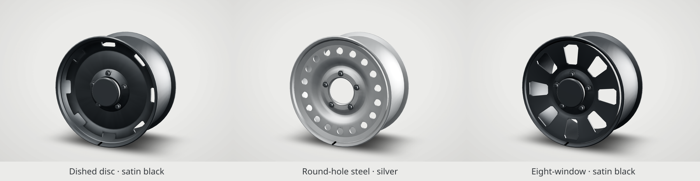
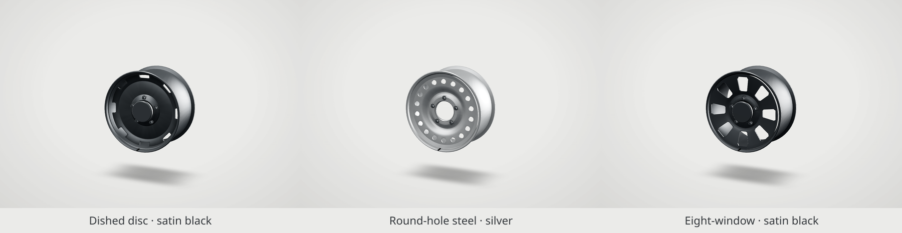
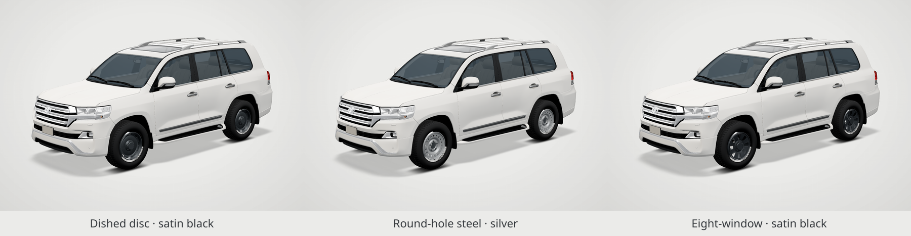

# Reference rim collection — 17-inch

Three unbranded interpretations of the supplied photographs, adapted to the live workshop's **5×150 LC200 mounting pattern**. Face styling follows the references; these are not certified manufacturer CAD models.

[](images/comparison.png)

[](images/comparison-with-tyres.png)

[](images/comparison-on-car.png)

## Full-size renders

Actual Three.js viewer captures at 1440 × 1000. Comparison sheets are resized layouts of these captures.

| View | Dished disc / satin black | Round-hole steel / silver | Eight-window / satin black |
|---|---|---|---|
| Bare rim 3/4 | [Open](images/disc-rim-quarter.png) | [Open](images/steel-rim-quarter.png) | [Open](images/window-rim-quarter.png) |
| Bare rim front | [Open](images/disc-rim-front.png) | [Open](images/steel-rim-front.png) | [Open](images/window-rim-front.png) |
| Bare rim back | [Open](images/disc-rim-back.png) | [Open](images/steel-rim-back.png) | [Open](images/window-rim-back.png) |
| Mounted close-up | [Open](images/disc-wheel-quarter.png) | [Open](images/steel-wheel-quarter.png) | [Open](images/window-wheel-quarter.png) |
| Car 3/4 | [Open](images/disc-car-quarter.png) | [Open](images/steel-car-quarter.png) | [Open](images/window-car-quarter.png) |
| Car side | [Open](images/disc-car-side.png) | [Open](images/steel-car-side.png) | [Open](images/window-car-side.png) |

[Native workshop selection](images/workshop-rims.png) · [Slate](images/window-car-slate.png) · [Clay](images/window-car-clay.png)

## Shapes and configured dimensions

- **Dished disc:** eight narrow slots, shallow circular pressing, raised hub shoulder, blank cap and five service nuts.
- **Silver pressed steel:** eighteen round vents, bowl-shaped pressing, open rolled centre and five nuts.
- **Eight-window:** eight large bevelled openings, broad spokes, blank cap and five nuts. The manufacturer's [Method 701 description](https://www.methodracewheels.com/products/701-matte-black) confirms the eight-window layout used as supplementary reference; no claim is made that this generic model reproduces a factory product exactly.

Each has a closed hollow barrel, rolled lips and seated valve. The photos show six-lug examples; the final parts use five lugs to match the current catalogue. No brand lettering, simulated wear, dirt or additional accessories were added.

| Design / native catalogue ID | Bead seat | Width (measured) | Catalogue offset | Centre bore in authored face |
|---|---:|---:|---:|---:|
| Dished disc / `kmc` | 431.8 mm / 17″ | 215.900 mm / 8.5″ | +18 mm | 110.1 mm |
| Silver steel / `steel` | 431.8 mm / 17″ | 203.200 mm / 8″ | +25 mm | 110.1 mm |
| Eight-window / `method` | 431.8 mm / 17″ | 215.900 mm / 8.5″ | 0 mm | 110.3 mm |

Offsets, widths and bore requirements follow `model/wheels.json` from Main `a52ad7b`. The flange diameter measures **462.0 mm**, intentionally larger than the nominal bead seat. The native catalogue's mount/width checks remain active, including its lateral-clearance notes. Real vehicle fit, steering/suspension clearance and physical iPad performance have not been validated.

## Assets and integration

| Design | Triangles per rim | Four GLBs, bytes |
|---|---:|---:|
| Dished disc | 10,292 | 942,040 |
| Silver pressed steel | 11,860 | 1,177,136 |
| Eight-window | 9,556 | 928,168 |
| Total | 12 new parts | 3,047,344 |

Blender **4.3.2**, Cycles AO bake at 32 samples. COLOR_0 R = AO, G = signed curvature (.5 flat), B reserved. Meshopt compression; root scale [1,1,1], hub pivots copied from the existing wheel slots. Editable sources: `model/source/rim-{disc,steel,window}.blend`.

The branch incorporates Main's new catalogue commit `a52ad7b`. Choose **Workshop → Rims**: the three custom entries are now built and selectable. Their canonical GLB loads on first use, then all four hub copies share its geometry/materials. The stored stock tyre and brake buffers remain unchanged. The native offset moves each tyre/rim rigidly; the brake stays on its hub. “Stock GXR alloy” restores the original hardware. Share/reset use Main's native `rim` build-state field.

Other tyre sizes remain unbuilt in the native catalogue, as on Main. Earlier tyre-review GLBs and documents remain in the branch unchanged, with their optional parts marked lazy; this rim task does not enable or re-label those tyre designs.

Existing car materials, camera presets and studio settings are preserved. New rims use the existing baked-shading and studio-material functions, including Clay's palette. No new realtime maps, effects or render passes. Stored car GLBs, NORMAL and COLOR_0 are untouched.

## Verification

- [Asset verification](reports/verification.json): **12 valid new rim GLBs; all 76 pre-task GLBs byte-identical** to `c480d15`. Root scale/pivots, finite attributes, unit normals, baked AO range, flange diameter and measured bead-seat width pass.
- [Viewer](reports/viewer-final.json): **31/31**, Cream + Slate and overhangLock, zero console errors, using the final native integration.
- [Workshop smoke](reports/workshop-smoke.log): **45/45**, desktop and emulated phone UI; existing mount/width rules retained.
- [Native-rim integration](reports/workshop-integration.json): **20/20** — real UI selection, four copies, unchanged stock tyre attribute hashes, retained brake/tyre visibility, configured rigid offsets, all studios, original-rim restoration, sharing/reset, zero console errors.
- [Default parity](reports/default-parity.json): clean-view 3/4 at 1440 × 1000, **0 changed pixels** in Cream, Slate and Clay versus Main `a52ad7b` when stock rims are selected.
- [Changed values](reports/changed-values.json) and [capture provenance](reports/captures.json).

Tests use Playwright Chromium with SwiftShader and a local unpacked Three.js 0.166.1. Production stays pinned to CDN 0.166.1. Phone UI is emulated; no physical-device claims.

Delivered on **rims-review** only; Main and Pages have not been modified by this work. The earlier six-lug review commit is superseded by this native-catalogue integration and five-lug assets.

## Rebuild

```sh
blender -b -t 4 --python tools/rims/model.py -- WORK/disc disc
blender -b -t 4 --python tools/rims/model.py -- WORK/steel steel
blender -b -t 4 --python tools/rims/model.py -- WORK/window window
node tools/rims/register.mjs REPO DEPS WORK/disc
node tools/rims/register.mjs REPO DEPS WORK/steel
node tools/rims/register.mjs REPO DEPS WORK/window
node tools/rims/verify.mjs REPO DEPS WORK
node tools/rims/check-workshop.mjs DEPS CHROMIUM WORK/workshop-integration.json
```

`tools/rims/preview.py` drives the existing test-only review server. Its baseline folder should contain Main `a52ad7b`'s index.html and links to the shared assets. `tools/rims/preview-workshop.mjs` captures the native panel after the camera settles.
