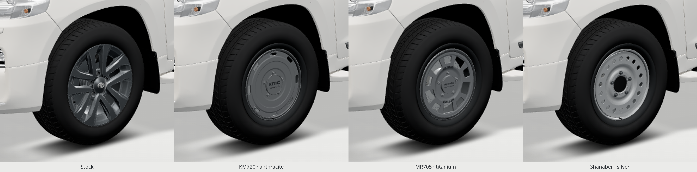
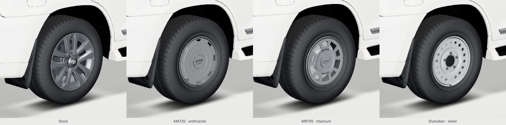

# LC200 rim likeness refinement — Cream

Review branch only; Main and Pages are unchanged. Baseline: `7adae34`.

## Visible changes

- **KM720 Roswell:** 132 mm cap (127 mm before), shaped KMC mark and WHEELS lettering, eight identical rounded capsules, clean planar face with two concentric steps, and an added outer bead/lip step. The cap clears the existing 5×150 service nuts; their positions are unchanged. Anthracite colour stays `#7b7f83`; roughness .68 → .58, metalness .50 → .65, environment intensity 1.5 → 1.8.
- **MR705:** ten rounded trapezoids in the source's alternating five-short/five-large arrangement. Windows are shorter radially and wider tangentially; the outer edge moves inward to leave a broad flat lip. Raised Bead Grip ring, curved METHOD face lettering top/bottom, small 112 mm cap. Titanium colour stays `#8a8f94`.
- **Shanaber:** no changes to the accepted pressing's vertex coordinates. Flat-face normals and baked shading no longer form radial seams at 12/6 o'clock or triangular streaks around the holes. Silver colour stays `#c4c9cc`.
- **Brakes:** brighter neutral rotor/caliper finishes, a visible dark-metal barrel return, bounded new-hardware AO, two fine machining witness rings, and two caliper fasteners. These 312 additional triangles per rim do not move the accepted brake or fit geometry. The rotor remains 354 mm: an outer Roswell vent can show barrel/backing instead of rotor, as dictated by the geometry. No oversized fake rotor or emissive lighting.
- **Studio:** Cream is the sole selectable look. The toggle and dataset dependency are removed. Existing Cream light/background/car finishes, cameras and controls remain. Old unused look helpers are left internal for compatibility with historical review tooling; non-Cream initialization is rejected.

## Current images

Product-style images omit adapters/backing/brakes for comparison with bare product photographs. Fitted images include the stock tyre and every fit/brake component.

| Rim | Front | 3/4 | With tyre | On car |
|---|---|---|---|---|
| KM720 | [Face](images/disc-rim-front.png) | [Face](images/disc-rim-quarter.png) | [Mounted](images/disc-wheel-quarter.png) | [3/4](images/disc-car-quarter.png), [Side](images/disc-car-side.png) |
| MR705 | [Face](images/window-rim-front.png) | [Face](images/window-rim-quarter.png) | [Mounted](images/window-wheel-quarter.png) | [3/4](images/window-car-quarter.png), [Side](images/window-car-side.png) |
| Shanaber | [Face](images/steel-rim-front.png) | [Face](images/steel-rim-quarter.png) | [Mounted](images/steel-wheel-quarter.png) | [3/4](images/steel-car-quarter.png), [Side](images/steel-car-side.png) |

Actual 3× enlargements of 320×300 crops from 1440×1000 frames, ordered **stock | KM720 | MR705 | Shanaber**:

[](images/comparison-cream-FL.png)

[](images/comparison-cream-RR.png)

Individual stock comparisons: [KM720 FL](images/stock-vs-kmc-FL.png) / [RR](images/stock-vs-kmc-RR.png), [MR705 FL](images/stock-vs-method-FL.png) / [RR](images/stock-vs-method-RR.png), [Shanaber FL](images/stock-vs-steel-FL.png) / [RR](images/stock-vs-steel-RR.png).

## Reference limitations and likeness

[KMC manufacturer page](https://www.kmcwheels.com/kmc-roswell), [Method manufacturer page](https://www.methodracewheels.com/products/705-matte-titanium), [TN01 Gulf supplier](https://wheel-tire.ae/product/fr-tn01-land-cruiser-steel-wheels/). Reference photographs stay outside Git and appear only in the chat report. URLs and limitations: [references.json](reports/references.json).

Method supplies official front and 3/4 photographs. KMC supplies near-front and 3/4 views; the exactly front-on supplementary catalogue picture is retailer-hosted. TN01 publishes one oblique photo, so a matching first-party front photograph could not be supplied. We do not relabel an oblique or unrelated photograph as a TN01 front view.

My subjective face-likeness estimates are **KM720 ~90%, MR705 ~90%, Shanaber ~92%**, not dimensional certification. Remaining differences: approximate cast lettering/mark bevels, simplified slot/pressing edge radii and lug-seat casting transitions; catalogue fit adaptations are intentional. TN01's optional FR cap and its 17×7 ET45 specification are not copied; the accepted 17×8 ET+25 LC200 configuration remains. Product-photo lighting is not reproduced exactly. Physical iPad and real vehicle fit are untested.

## Measured asset budget

| Rim | Triangles per complete rim | FL GLB bytes | Catalogue |
|---|---:|---:|---|
| KM720 | 14,692 | 328,444 | 17×8.5 ET+18 · 5×150 |
| MR705 | 17,940 | 397,344 | 17×8.5 ET0 · 5×150 |
| Shanaber | 14,255 | 331,432 | 17×8 ET+25 · 5×150 |

All 12 corner assets total **4,255,168 bytes**, versus **3,679,584** before (+575,584 bytes). `index.html`: **106,680 → 105,808 bytes**. New-rim structural budget is 20k triangles; Method exceeds the previous 15k ceiling because of geometry lettering. No new effects, passes, maps or post-processing. Three remains pinned to 0.166.1; root scales/pivots/fit rules remain.

## Verification

- **20/20 rims, 45/45 workshop, 31/31 viewer; zero console errors.** Cream only. Chromium/SwiftShader; workshop phone viewport is emulated.
- All **56 stored car GLBs byte-identical**, including their NORMAL/COLOR_0. [Hashes and structural checks](reports/verification.json).
- Accepted adapters, mounting offsets and brake coordinates unchanged. All accepted steel coordinates unchanged; added brake details are separate material geometry. [Coordinate hashes](reports/fit-geometry-lock.json).
- **2,094 wheel coverage rays, zero misses** over FL/RR vent, bead-band and hub samples. This proves sampled opaque coverage, not brake visibility in every possible camera. [Coordinates/crops](reports/gap-proof.json).
- [Changed values with file/line](reports/changed-values.json), [rims checks](reports/rims20.json), [viewer checks](reports/viewer31.json), [workshop checks](reports/workshop45.log), [provenance](reports/provenance.json).

## Reproduce

Dependencies are external in `DEPS`, containing Playwright, Sharp, glTF Transform, Meshopt and the unpacked pinned Three package. `WORK` is an external temporary directory. Blender used: **4.3.2**, Cycles CPU vertex AO, 32 samples.

```sh
blender -b -t 4 --python tools/rims/model.py -- "$WORK/disc" disc
node tools/rims/register.mjs "$PWD" "$DEPS" "$WORK/disc"
# Repeat for window and steel.
node tools/rims/verify.mjs "$PWD" "$DEPS" "$WORK"
node tools/rims/check-workshop.mjs "$DEPS" /usr/bin/chromium "$WORK/rims20.json"
node tools/workshop/smoke.mjs "$DEPS" /usr/bin/chromium
node tests/visual.mjs --checks-only --deps "$DEPS" --three-dir "$DEPS/package" --chromium /usr/bin/chromium --output "$WORK/viewer"
node tools/base-finish/round4b/review-server.mjs "$PWD" "$DEPS" "$WORK"
# Once READY, in another terminal:
LC_RIM_WORKDIR="$WORK" python tools/rims/review-capture.py
node tools/rims/make-crops.mjs "$DEPS" "$WORK" "$WORK/crops"
```

To reproduce the fit comparison, bake the `tools/rims/model.py` from `7adae34` into a separate old-bake root, then run `tools/rims/compare-fit.py OLD_BAKES NEW_BAKES OUTPUT.json`. The stored car is never a generator input.
