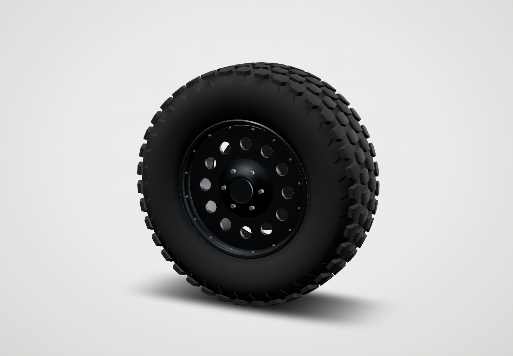
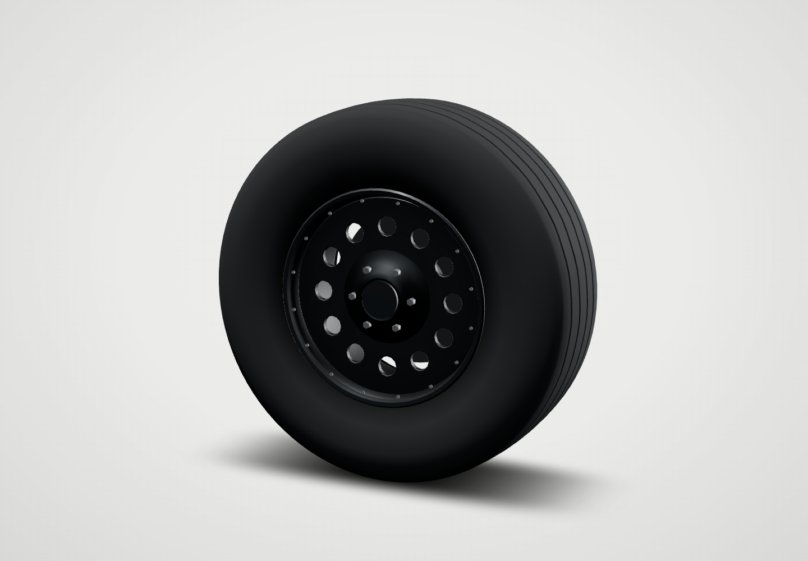
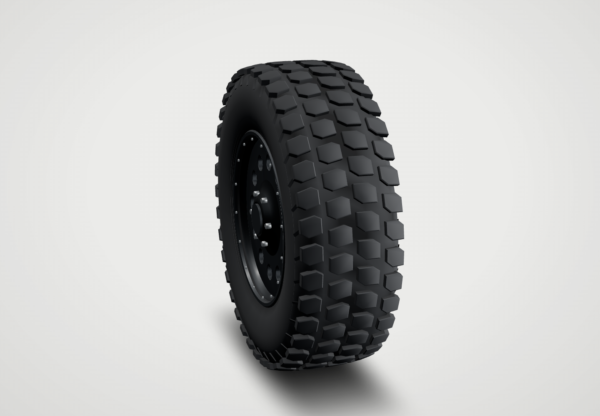
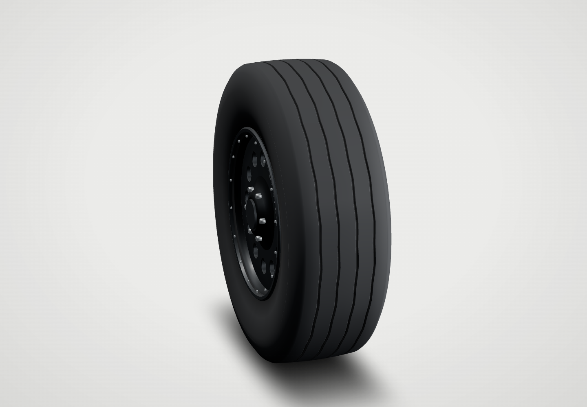
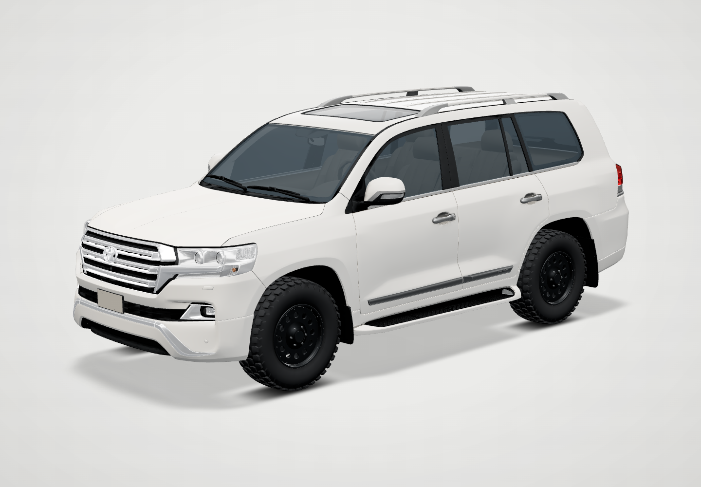
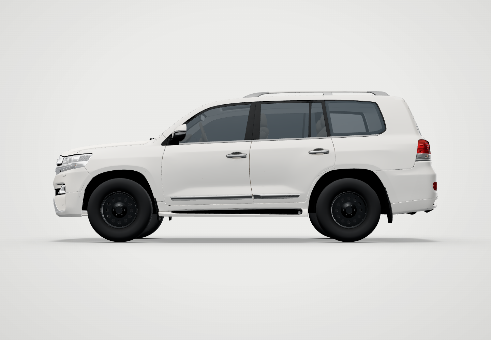

# 265/70R17 workshop tyres

Two new options, sharing the approved 17-inch dark pressed-steel wheel:

- **Expedition AT:** approved A tread, authored in 265/70R17.
- **Ribbed highway:** the supplied photograph interpreted as four narrow zigzag grooves / five continuous ribs, rounded shoulders and a smooth, unbranded sidewall. Also 265/70R17, as stated during the build; no separate size was supplied for this option.

These are new meshes, not resized stored wheel GLBs. Existing vehicle geometry, normals, COLOR_0, body proportions, materials and camera code are untouched by the tyre addition. Default build remains stock; choose either option under Workshop → Wheels. No roof gear, lift, mud, lettering or other accessories were added.

## Rendered previews

Actual viewer renders at 1440 × 1000, using its Cream studio. Click any image for full size.

[Tyres side by side](images/comparison.png) · [On-car comparison](images/comparison-on-car.png)

| Expedition AT | Ribbed highway |
|---|---|
| [](images/at26570-tyre-quarter.png) | [](images/ht26570-tyre-quarter.png) |
| [](images/at26570-tyre-tread.png) | [](images/ht26570-tyre-tread.png) |
| [](images/at26570-car-quarter.png) | [](images/ht26570-car-quarter.png) |
| [](images/at26570-car-side.png) | [](images/ht26570-car-side.png) |

[Highway bare casing](images/ht26570-bare-quarter.png) · [AT wheel face](images/at26570-tyre-front.png) · [Highway wheel face](images/ht26570-tyre-front.png) · [Slate](images/ht26570-car-slate.png) · [Clay](images/ht26570-car-clay.png)

## Measured assets

| Quantity | Expedition AT | Ribbed highway |
|---|---:|---:|
| Nominal size | 265/70R17 | 265/70R17 |
| Calculated diameter | 802.8 mm | 802.8 mm |
| Exported maximum diameter | 802.790 mm | 802.800 mm |
| Exported maximum rubber width | 265.000 mm | 265.000 mm |
| Triangles per complete wheel | 14,660 | 14,860 |
| Four Meshopt GLBs | 1,568,280 bytes | 1,308,240 bytes |

Nominal diameter calculation: 17 × 25.4 + 2 × 265 × 0.70 = 802.8 mm. This is a nominal design calculation, not a manufacturer's measured tyre specification. The rim's bead seat is 431.8 mm; its rolled flange extends beyond the bead seat normally.

Blender **4.3.2**, Cycles AO bake, 24 samples. COLOR_0: R = AO, G = signed curvature (.5 flat), B reserved. Each wheel includes tyre, rim, fasteners and brake, with four independent finish zones. Rubber is dark charcoal and matte; hardware retains the existing approved steel-wheel finish. No new runtime maps, effects or render passes.

Four hub frames per design, root scale [1,1,1]. The existing build system raises the wheel and body groups rigidly by **4.9 mm** for these diameters; suspension lift remains 0. Model-only static arch clearance reports **56 mm front / 89 mm rear**. Steering lock, suspension travel, real vehicle fit, road suitability and physical iPad performance are untested.

## Verification and scope

- [Asset verification](reports/verification.json): eight new GLBs pass dimensions, hub pivots, root scale, attribute integrity, AO range and ≤15,000 triangles; **68 pre-existing GLBs byte-identical** to integration baseline `d2e833d`.
- [Viewer checks](reports/viewer.json): **31/31**, Cream + Slate, overhangLock included, zero console errors.
- [Capture provenance](reports/captures.json): all screenshots are from this branch's index.html and new assets; zero recorded console errors.
- [Workshop smoke](reports/workshop-smoke.log): **31/31**; [new-option integration](reports/workshop-integration.json): **10/10** — real UI selection, four-wheel installation, rigid ride adjustment, studio cycling and stock reset.

The review branch combines the existing `car-polish` finish and approved tyre catalogue in merge `d2e833d`, so the car previews use the current car finish. The new tyre addition changes only the catalogue/manifest, new tyre assets, their sources, tools and this evidence. Main/Pages are not modified.

## Rebuild

With repository, dependencies and work-directory paths substituted:

```sh
blender -b -t 4 --python tools/tyre-26570/model.py -- WORK/at 265 70 at
blender -b -t 4 --python tools/tyre-26570/model.py -- WORK/ht 265 70 ht
node tools/tyre-26570/register.mjs REPO DEPS WORK/at
node tools/tyre-26570/register.mjs REPO DEPS WORK/ht
node tools/tyre-26570/verify.mjs REPO DEPS WORK
node tools/tyre-26570/check-workshop.mjs DEPS CHROMIUM WORK/workshop-integration.json
```

Editable Blender sources: `model/source/tyre-at26570.blend`, `model/source/tyre-ht26570.blend`. Screenshot tool `tools/tyre-26570/preview.py` drives the existing test-only review server; production retains the pinned CDN Three.js 0.166.1 importmap.
